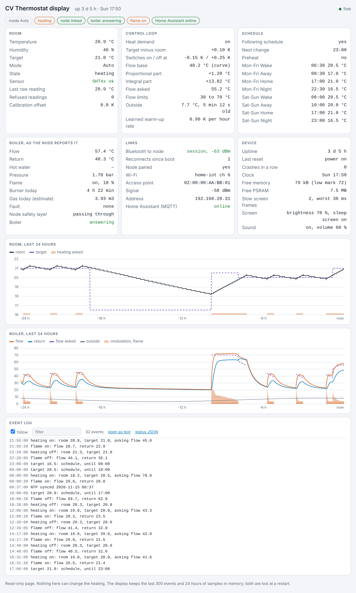
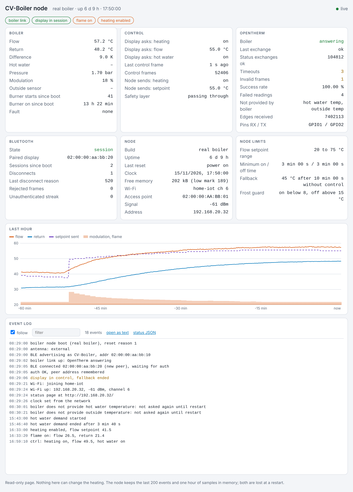

# 🔥 CV Thermostat: DIY OpenTherm Thermostat

> **Your boiler, your rules.** A two-device OpenTherm thermostat for a Remeha Tzerra Ace 39C: a touch display in the living room, a small node at the boiler, an encrypted Bluetooth link between them. Works without Wi-Fi, without cloud, without Home Assistant. 🚫☁️

<!-- Add a photo of your build here, for example:  -->

---

## 🎯 Project Overview

A **Waveshare ESP32-S3 touch display** in the living room is the thermostat: screen, schedule, control loop and room sensor. A **Seeed XIAO ESP32C6** at the boiler speaks OpenTherm through a **DIYLESS Master OpenTherm Shield** and guards the boiler with its own safety layer. The two talk over an authenticated, encrypted Bluetooth LE link.

Wi-Fi, MQTT, Home Assistant and the two status pages are extras. With the network down, the display, the schedule and the boiler link keep working.

| Aspect | Details |
|--------|---------|
| **Difficulty** | ⭐⭐⭐ Advanced |
| **Build Time** | ~4-8 hours |
| **Projects** | `Thermostat/` (display) and `BoilerNode/` (node), both PlatformIO |
| **Display** | Waveshare ESP32-S3-Touch-LCD-3.5 |
| **Node** | Seeed XIAO ESP32C6 + DIYLESS Master OpenTherm Shield |
| **Tested Boiler** | Remeha Tzerra Ace 39C |
| **Framework** | Arduino (PlatformIO), LVGL 8.4 |

### 🏗️ Architecture

```
 Living room                                      Boiler cupboard
+---------------------------------+              +---------------------------+
| Waveshare ESP32-S3-Touch-LCD-3.5|  Bluetooth,  | Seeed XIAO ESP32C6        |
|  touch UI, schedule, control    |<------------>|  safety layer             |
|  SHT45 room sensor              | authenticated|  OpenTherm master         |
|  clock, speaker                 |  + encrypted |  fallback without display |
+---------------+-----------------+              +------+------------+-------+
                | Wi-Fi (optional)                      | Wi-Fi      | 2 wires
                v                                       | (optional) v
   MQTT -> Home Assistant, status page          status page    Remeha Tzerra Ace 39C
```

### 📐 Design Rules

- 🧠 The thermostat logic lives on the display. The node relays, and guards the boiler.
- 📴 Nothing in the heating path depends on Wi-Fi, MQTT, Home Assistant or a web page.
- 🔐 The node acts only on commands from an authenticated session. Without one it heats to a fixed, modest flow temperature, so the house does not go cold because a display died.
- 🛡️ Whatever reaches the node, even correctly authenticated, passes its own safety layer first.
- 🔌 Both devices are flashed over USB only. Neither accepts firmware over the network.

---

## 📁 Repository Files

| Path | Description |
|------|-------------|
| `Thermostat/` | Display firmware (PlatformIO project): `src/`, `include/`, `lib/` (display libraries), `web/` (status page source) |
| `BoilerNode/` | Node firmware (PlatformIO project): `src/`, `include/`, `web/` |
| `gen_ble_key.py` | Makes the shared Bluetooth key for both devices |
| `homeassistant/` | Dashboard and automations to paste into Home Assistant |
| `tests/` | PC tests of the control logic, the safety layer and the link encryption |
| `img/` | Screenshots for this README |
| `THIRD-PARTY-NOTICES.md` | Licenses of the bundled and downloaded libraries |
| `README.md` | This file |

> 🔒 Three files hold your own settings and are **never** part of the repo (they are in `.gitignore`): `Thermostat/include/secrets.h`, `BoilerNode/include/node_secrets.h` and `include/ble_key.h` in both projects.

---

## 📦 Hardware

### Shopping List

| Component | Supplier | Notes |
|-----------|----------|-------|
| **Waveshare ESP32-S3-Touch-LCD-3.5** | Amazon | Display and thermostat: [Link](https://www.amazon.nl/dp/B0F3WS2W5R) |
| **Seeed XIAO ESP32C6** | Kiwi Electronics | Boiler node: [Link](https://www.kiwi-electronics.com/en/seeed-studio-xiao-esp32c6-20076) |
| **Master OpenTherm Shield** | DIYLESS | Between the node and the boiler's two-wire bus: [Link](https://diyless.com/product/master-opentherm-shield) |
| **2.4GHz WiFi Antenna (uFL)** | Kiwi Electronics | For the node, not included with the board: [Link](https://www.kiwi-electronics.com/nl/2-4ghz-mini-flexibele-wifi-antenne-met-ufl-connector-11062) |
| **Sensirion SHT45 breakout** | Any | Room temperature and humidity (SHT40/41 also work) |

### Additional Materials
- 2× USB 5V power supply, one per device
- 2× USB-C cable (also used for flashing)
- Thin wire for the sensor and the shield
- Two-core low voltage cable from the shield to the boiler terminals
- Soldering iron

---

## 🔌 Wiring

### SHT45 Room Sensor → Display (32-pin header)

| Header Pin | Signal | SHT45 |
|------------|--------|-------|
| 32 | 3V3 | VDD |
| 30 | GND | GND |
| 28 | SDA (GPIO8) | SDA |
| 26 | SCL (GPIO7) | SCL |

> ⚠️ **Note:** This is the board's main I2C bus, shared with touch, power chip, clock and audio. A short on the sensor lead also freezes the touch screen.

> 💡 **Tip:** The firmware looks for the sensor first on a bus of its own (SDA GPIO48 on pin 23, SCL GPIO47 on pin 21, 3V3 pin 31, GND pin 29) and then on the main bus, so either wiring works. Do not use GPIO45 or GPIO46 for it.

### OpenTherm Shield → XIAO ESP32C6

| OpenTherm Shield | XIAO ESP32C6 |
|------------------|--------------|
| IN | D1 (GPIO1), the node reads the boiler here |
| OUT | D2 (GPIO2), the node sends here |
| VCC | 3V3, **never 5V** |
| GND | GND |
| Two bus terminals | Boiler R-Bus / OT terminals, either way round |

> ⚠️ **Important:** Only one controller may be on the boiler's terminals. Disconnect the old thermostat first, and power-cycle the boiler after connecting so it detects OpenTherm.

> 💡 **Tip:** Not sure about IN and OUT? Flash the `xiao_c6_real_swapped` build: it exchanges the two pins in software, so you can test for crossed wires without soldering.

### Antenna

The XIAO ESP32C6 has an onboard RF switch for antenna selection. The node firmware selects the **external** antenna at boot via GPIO3 and GPIO14, so plug the uFL antenna into the connector on the board. To use the onboard antenna instead, set `USE_EXT_ANTENNA` to `0` in `BoilerNode/src/main.cpp`.

---

## 📋 Pin Configuration

### Boiler Node (XIAO ESP32C6)

| Pin Label | GPIO | Function | Notes |
|-----------|------|----------|-------|
| D1 | GPIO1 | OpenTherm receive | To shield pin IN |
| D2 | GPIO2 | OpenTherm send | To shield pin OUT |
| - | GPIO3 | RF Switch Control | Reserved, antenna control |
| - | GPIO14 | Antenna Select | Reserved, external antenna |
| - | GPIO15 | User LED | On while the burner flame is on |

### Display (Waveshare ESP32-S3-Touch-LCD-3.5)

| Header Pin | GPIO | Function | Notes |
|------------|------|----------|-------|
| 28 | GPIO8 | I2C SDA | Main bus, room sensor |
| 26 | GPIO7 | I2C SCL | Main bus, room sensor |
| 23 | GPIO48 | I2C SDA (optional) | Separate sensor bus |
| 21 | GPIO47 | I2C SCL (optional) | Separate sensor bus |

Everything else on the display (LCD, touch, power chip, clock, speaker) is on the board itself.

---

## ✨ Features

### Display
- 🎛️ **Dial thermostat** with 0.5 degree steps, drag fully left for Off
- 📅 **Weekly schedule**: Mon-Fri and Sat-Sun, four blocks each
- ⏱️ **Preheating**: learns how fast the room warms and starts early
- 🌤️ **Weather-compensated** flow temperature when an outdoor value is available
- 😴 **Sleep screen** after 60 seconds: big clock with the weekday, room temperature, mode and target
- 📈 **Boiler screen**: temperatures, pressure, modulation, 2-hour chart, fault reset
- 🔊 **Sounds** with volume control, brightness control

### Boiler Node
- 🔥 **OpenTherm master**: flow setpoint, heating and hot water enable, readings, fault reset
- 🛡️ **Own safety layer**, see Safety Features below
- 🏠 **Fallback heating** when the display is gone
- 🙅 **Tolerant of the boiler**: values the boiler does not provide are skipped, a single failed exchange changes nothing

### Connectivity
- 🔐 **Bluetooth LE** between display and node: mutual authentication, AES-256-CCM, pinned peer
- 🏠 **Home Assistant** via MQTT discovery: climate entity, sensors, diagnostics
- 🌐 **Read-only status pages** on both devices: live values, charts, event log
- 🔌 **USB-only flashing**, no update over the network

---

## 🖥️ Using the Display

| Screen | What it does |
|--------|--------------|
| **Home** | Dial for the target, room temperature, state, four tiles (radiator water, humidity, pressure, modulation), Auto / Manual / Off |
| **Boiler** | Radiator, return and hot-water temperature, burner time today, 2-hour chart, pressure, modulation, estimated gas, last fault, two-tap fault reset |
| **Settings** | State of room sensor, Wi-Fi, Home Assistant and boiler link; sleep screen and sound toggles; volume and brightness |
| **Schedule** | Wake, Away, Home, Night for Mon-Fri and Sat-Sun: start time in 15-minute steps, temperature in 0.5 degree steps |
| **Clock** | Only needed without Wi-Fi; network time overrides it |
| **Sleep** | After 60 seconds without a touch. A touch wakes the display and presses nothing |

### Modes

| Mode | Behaviour |
|------|-----------|
| **Off** | No heating, except frost protection: below 6 degrees in the room it heats until 7.5 |
| **Manual** | Holds the dial value. Shown as "heat" in Home Assistant |
| **Auto** | Follows the schedule. Moving the dial, or a target from Home Assistant, holds until the next block. If the next block is warmer, heating starts early (Preheating) |

> 💡 **Tip:** A long press on the OpenTherm row in Settings forgets the paired node. Use it when you replace the node.

> ⚠️ **Note:** A sensor fault, a boiler fault or safe mode keeps the full screen on instead of the sleep screen.

---

## 🧠 How It Decides

Once a second, on the display (`tl_control()` in `Thermostat/include/thermo_logic.h`):

| Step | Rule |
|------|------|
| **Heat demand** | On when the room is more than 0.15 K below target, off when more than 0.25 K above |
| **Flow temperature** | base + 12 × error + integral part, between 30 and 70 degrees |
| **Base (heating curve)** | 30 + 1.4 × (15 - outside), between 30 and 65 |
| **No outdoor value** | Base is 38. A value older than 2 hours counts as none |
| **Preheat** | Lead time from the learned warm-up rate, at most 2 hours |

> 🔧 The tuning values are in `CtrlParams` in the same file. They are reasonable starting values for radiators. Adjust them to your house.

---

## 🛡️ Safety Features

| Situation | What happens |
|-----------|--------------|
| Room sensor silent or implausible for 30 s | **SENSOR FAULT** on the dial. In Auto or Manual the display asks a fixed 40 degree flow. In Off it stays off and the node's frost guard remains |
| Display stops sending for 10 minutes | Node heats at a fixed 45 degrees flow (**fallback**) |
| Display asks for something absurd | Node ignores values outside 10 to 90 degrees and limits the rest to 20 to 75 |
| Heating switched rapidly | Node enforces 3 minutes minimum on and 3 minutes minimum off |
| Water at the boiler below 8 degrees | Node heats at 35 degrees until above 15, whatever the display says (**frost guard**) |
| One OpenTherm exchange fails | Nothing: the boiler counts as gone only after five in a row |
| A device hangs | Its watchdog restarts it after 30 s |
| Display crashes three times in a row | **Safe mode**: display, control and boiler link only; Wi-Fi, MQTT and sound stay off |

> ⚠️ **Floor heating:** The node's limits are in `SafetyParams` in `BoilerNode/include/node_safety.h`. Lower `flowMax_c10` (75 degrees as delivered) **before** connecting the boiler.

---

## 🌐 Web Interface

Both devices can serve a **read-only** status page: live values, charts and an event log.

| | Display | Node |
|---|---------|------|
| **Address** | `http://thermostat.local/` or its IP | Its IP, printed on the serial monitor |
| **Switched on by** | `WEB_PASS` in `secrets.h` | The file `node_secrets.h` |
| **Charts** | 24 hours, one sample a minute | 1 hour, one sample per 10 s |
| **Event log** | Last 300 events | Last 200 events |

### Display Page



### Node Page



### Addresses

| Address | Content |
|---------|---------|
| `/` | The page |
| `/api/status` | Everything on the page as JSON |
| `/api/log?since=N` | Event log as JSON, only lines after sequence number N |
| `/api/history` | Chart samples as JSON |
| `/log.txt` | Event log as plain text with date and time |

### Why This Is Acceptable on a Boiler Controller

- 👀 **Read-only.** No request changes the heating, the schedule, the limits, the pairing or the firmware. Only GET is answered.
- 🧵 **Own task.** The server runs beside the control loop and reads a copy of the state. The loop never waits for it.
- 🔑 **Login.** HTTP Basic. Wrong guesses are slowed to one per second.
- 🙈 **No secrets shown.** Neither page shows a password or the Bluetooth key.

> ⚠️ **Important:** HTTP Basic is not encrypted on the wire. Use a password that is used nowhere else and keep both devices on your IoT network.

> 💡 **Tip:** Charts and logs live in memory and are lost at a restart. Home Assistant keeps the long-term history. To change a page, edit `web/page.html` in the project and run `python web/make_page.py` there.

---

## 🏠 Home Assistant Integration

The display announces itself over MQTT discovery. No YAML is needed for the entities: one device, **CV Thermostat**, with a climate entity, boiler sensors, status sensors and diagnostics.

### MQTT Topics (base `cv/thermostat`)

| Topic | Direction | Content |
|-------|-----------|---------|
| `status` | Out, retained | `online` / `offline` |
| `state` | Out | JSON when something changes, and once a minute |
| `diag` | Out | JSON every 30 s: health, link quality, signal levels |
| `set/target` | In | Number, 5 to 30, rounded to 0.5 |
| `set/mode` | In | `off`, `heat` (Manual), `auto` |
| `set/outside` | In | Outdoor temperature for the heating curve |

### Available Entities

#### Climate
- **CV Thermostat**: target, mode (off / heat / auto), current temperature

#### Sensors
- Humidity, Radiator water, Return water, Hot water, Boiler pressure, Modulation, Flow request, Boiler fault code

#### Binary Sensors
- Flame, Boiler link, Boiler fault, Boiler node in fallback, Room sensor fault, Frost protection active, Preheating, Safe mode

#### Diagnostics
- Wi-Fi signal, Boiler link signal, Boiler link reconnects, Uptime, Free memory minimum, Last reset reason, Crash count, Learned warm-up rate, Outdoor temperature used

### 📬 Ready-made Files

| File | What it does |
|------|--------------|
| `homeassistant/dashboard-heating.yaml` | A heating view: add a view, switch it to YAML, paste |
| `homeassistant/automation-outside-temperature.yaml` | Sends a weather entity's temperature to the display on change and every 15 minutes |
| `homeassistant/automations-alerts.yaml` | Notifications for fallback, lost link, sensor fault, boiler fault, low pressure, frost protection, display offline, safe mode or a crash |

> 💡 **Tip:** MQTT over TLS: set `MQTT_TLS 1`, port 8883 and `MQTT_CA_CERT` in `secrets.h`.

---

## 🚀 Installation

### Step 1: Set up the PC (Windows)

In a normal command prompt:

```
pip install platformio esptool
```

In PowerShell as Administrator, then reboot (the node's toolchain has very long paths):

```powershell
New-ItemProperty -Path "HKLM:\SYSTEM\CurrentControlSet\Control\FileSystem" -Name LongPathsEnabled -Value 1 -PropertyType DWORD -Force
```

Find the serial port of a connected device (`VID:PID=303A:1001`):

```
python -m serial.tools.list_ports -v
```

### Step 2: Generate the Bluetooth key

From the folder that contains `Thermostat` and `BoilerNode`:

```
python gen_ble_key.py
```

It writes the same random 256-bit key into both `include/ble_key.h` files and refuses to overwrite an existing one. `--force` makes a new key; both devices must then be flashed again.

### Step 3: Configure secrets

**Display:** copy `Thermostat/include/secrets.example.h` to `secrets.h` and fill in Wi-Fi, the MQTT broker and, for the status page, `WEB_USER` and `WEB_PASS`.

**Node:** copy `BoilerNode/include/node_secrets.example.h` to `node_secrets.h`. Without that file the node has no Wi-Fi at all and works over Bluetooth only.

> ⚠️ **Important:** In these files a backslash inside a text is written `\\` and a double quote `\"`. A single backslash is dropped by the compiler without a warning and gives a wrong password.

### Step 4: Flash the display

Set your serial port in `Thermostat/platformio.ini` (`upload_port`, `monitor_port`), then:

```
cd Thermostat
pio run -t upload
pio device monitor
```

### Step 5: Flash the node

```
cd BoilerNode
pio run -e xiao_c6_real -t upload --upload-port COMx
pio device monitor --port COMx
```

| Node Build | Use |
|------------|-----|
| `xiao_c6_real` | The real boiler over the OpenTherm shield |
| `xiao_c6_real_swapped` | Same, with the two signal pins exchanged in software |
| `xiao_c6` (default) | A simulated boiler, for the desk |

> 💡 **Tip:** Start with `xiao_c6` on the desk. Display and node pair, and you can try every screen before going near the boiler.

### Step 6: Connect the boiler

1. Lower `flowMax_c10` in `node_safety.h` first if you have floor heating
2. Switch the boiler off and disconnect the old thermostat
3. Connect the shield's two bus terminals to the boiler's R-Bus / OT terminals
4. Power the node, then switch the boiler on
5. The node's monitor shows `ot=ok` and the display shows boiler values within a few seconds

---

## 🔒 Security

- 🔐 **Bluetooth:** mutual authentication with a 256-bit shared key, then AES-256-CCM on every frame with a strictly increasing counter. Forged, altered or replayed frames are dropped. Each device remembers the other's address and ignores strangers.
- 🛡️ **Safety layer:** applies to authenticated commands too.
- 🔌 **Firmware:** only over USB. There is no update over the network on either device.
- 📨 **MQTT:** can only set target, mode and outdoor temperature, within fixed ranges. Give the broker user access to `cv/thermostat/#` and `homeassistant/#` only.

> ⚠️ **Not done on purpose:** secure boot and flash encryption. Someone with the device in hand and a USB cable can read the keys from it.

---

## 🔧 Troubleshooting

Start with the status page of the device, or its serial monitor. The display prints a line every 5 seconds (`hb ...`), the node one starting with `st:`.

### Bluetooth link

| Symptom | Likely cause and fix |
|---------|----------------------|
| Display: "node not linked", node log ends in `adv` | Display off, out of range, or built with another key |
| "auth fail" on the Boiler screen | The two devices have different `ble_key.h`. Generate once, flash both |
| "mismatch" on the Boiler screen | Display and node were built from different sets of files. Flash both from the same set |
| "looking for paired node" after replacing the node | Long-press the OpenTherm row in Settings |

### Boiler

| Symptom | Likely cause and fix |
|---------|----------------------|
| Node: `ot=timeout`, `edges` stays 0 | Boiler not answering: crossed signal wires (IN to D1, OUT to D2), a loose wire, another controller on the terminals, or the boiler was not power-cycled |
| Node: `ot=invalid`, `edges` climbing | A poor joint or interference on the two signal wires |
| Node log: "boiler does not provide ..." | Normal: this boiler has no such value; the node stops asking for it |

### Display

| Symptom | Likely cause and fix |
|---------|----------------------|
| "SENSOR FAULT" on the dial | No plausible room reading for 30 s. Check the sensor lead |
| "SAFE MODE" in the top bar | Three abnormal restarts in a row. Heating works. After two minutes of clean running, restart the display |

### Network

| Symptom | Likely cause and fix |
|---------|----------------------|
| Wi-Fi reason 15 or 204 | Wrong password as compiled (check the backslash rule in Step 3) |
| Wi-Fi reason 201 | Network not visible on 2.4 GHz |
| `MQTT connect failed, rc=5` | Broker rejected user or password |
| `MQTT connect failed, rc=-2` | Broker not reachable from the display's network |
| Status page asks for the login again and again | Wrong `WEB_USER` / `WEB_PASS` as compiled |
| Entities appear under odd names in Home Assistant | On the device page use "Recreate entity IDs" |

---

## 🧪 Tests

`tests/run.sh` (Linux or WSL, needs g++ and libmbedtls-dev) runs the PC tests of the control law, schedule and preheat, the node's safety layer, and the handshake and frame encryption.

```bash
sudo apt install g++ libmbedtls-dev
sh tests/run.sh
```

> ⚠️ **Note:** They check the logic. They do not replace building for the boards.

---

## 📊 Technical Specifications

| Parameter | Value |
|-----------|-------|
| **Display Board** | Waveshare ESP32-S3-Touch-LCD-3.5, 320×480, capacitive touch |
| **Node Board** | Seeed XIAO ESP32C6, external uFL antenna |
| **Room Sensor** | Sensirion SHT45 (I2C) |
| **Boiler Protocol** | OpenTherm, node is the master |
| **Link** | Bluetooth LE, node advertises as `CV-Boiler` |
| **Link Security** | HMAC-SHA256 handshake, AES-256-CCM frames, pinned peer |
| **Control Loop** | Once per second on the display |
| **Target Range** | 5 to 30 degrees, 0.5 degree steps |
| **Flow Range (display)** | 30 to 70 degrees |
| **Flow Range (node)** | 20 to 75 degrees |
| **Minimum On / Off** | 3 minutes / 3 minutes |
| **Fallback** | 45 degrees flow after 10 minutes without control |
| **Watchdog** | 30 s on both devices |
| **Web Server Port** | 80 (HTTP), read-only |
| **Flashing** | USB only |

---

## ⚠️ Known Limits

- The Tzerra Ace does not report hot-water temperature or an outdoor sensor over OpenTherm; both show as empty.
- The control tuning uses starting values and has not been adjusted to every house.
- The node is built with the latest 1.x release of the OpenTherm library and the current pioarduino platform. To freeze them, run `pio pkg list` in `BoilerNode` and write the reported releases into its `platformio.ini`.
- Charts and event logs do not survive a restart.
- Tested on one boiler only. Other OpenTherm boilers should work, but nobody has tried.

---

## 🙏 Credits

This project stands on the shoulders of great hardware and community work:

- **[DIYLESS Electronics](https://github.com/diyless)** ([diyless.com](https://diyless.com)): the **Master OpenTherm Shield** that connects the node to the boiler. Thank you for making OpenTherm hardware this easy to get and to use. 🙌
- **[Ihor Melnyk, OpenTherm Library](https://github.com/ihormelnyk/opentherm_library)**: the OpenTherm protocol implementation on the node
- **[LVGL](https://github.com/lvgl/lvgl)**: the graphics library behind the touch UI
- **[h2zero, NimBLE-Arduino](https://github.com/h2zero/NimBLE-Arduino)**: the Bluetooth LE stack on both devices
- **[knolleary, PubSubClient](https://github.com/knolleary/pubsubclient)**: MQTT
- **[moononournation, Arduino_GFX](https://github.com/moononournation/Arduino_GFX)**, **[lewisxhe, SensorLib](https://github.com/lewisxhe/SensorLib)** and **[XPowersLib](https://github.com/lewisxhe/XPowersLib)**, **[Rob Tillaart, TCA9554](https://github.com/RobTillaart/TCA9554)**: the display board drivers
- **Waveshare** and **Espressif**: board examples and the ES8311 audio codec driver
- **[pioarduino](https://github.com/pioarduino/platform-espressif32)** and **[PlatformIO](https://platformio.org)**: the build platform

---

## 📄 License

Released into the **public domain** under [The Unlicense](https://unlicense.org): no ownership, no restrictions. Use it, modify it, make it yours! 🛠️

The bundled libraries in `Thermostat/lib/` and the libraries downloaded at build time keep their own licenses, see [THIRD-PARTY-NOTICES.md](THIRD-PARTY-NOTICES.md).

## ⚠️ Disclaimer

```
⚠️  IMPORTANT SAFETY NOTICE  ⚠️

This project controls a gas boiler.

- It is not certified and not approved by any boiler manufacturer
- Connecting your own controller may affect your warranty or service contract
- Wrong limits can overheat floor heating or leave a house without heat
- Keep the original thermostat so you can put it back

USE AT YOUR OWN RISK!

The creator assumes NO LIABILITY for any damages or injuries.
```

This project is not affiliated with Remeha, DIYLESS, Waveshare or Seeed Studio.

---

**Boards**: Waveshare ESP32-S3-Touch-LCD-3.5 + Seeed XIAO ESP32C6  
**Boiler**: Remeha Tzerra Ace 39C  

**Made with ❤️ and 🔥**
